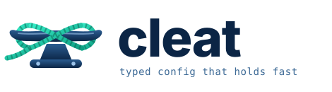

<p align="center">
  <picture>
    <source media="(prefers-color-scheme: dark)" srcset="assets/logo-dark.svg">
    
  </picture>
</p>

<p align="center">
  <strong>Typed configuration for Kubernetes.</strong><br>
  Real types from the Kubernetes API and your CRDs, errors at the exact field that's wrong,<br>
  and plain YAML out: for Argo CD, Flux, or <code>kubectl apply</code>.
</p>

<p align="center">
  <a href="https://github.com/xorps/test-lang/actions/workflows/ci.yml"></a>
  
  
</p>

> [!WARNING]
> **Cleat is under active development.** The language, the CLI and the
> editor and Argo CD integrations can change in incompatible ways between
> commits, and it hasn't been used in production yet.

## A taste

```ts
import * as k8s from "../schemas/kubernetes-1.37.json"

input env: "dev" | "prod"
input image: Str
input replicas: Int where self >= 1 = 2

export k8s.Deployment {
  metadata.name: "api",
  spec: {
    replicas: if env == "prod" then max(replicas, 3) else replicas,
    selector.matchLabels.app: "api",
    template: {
      metadata.labels.app: "api",
      spec.containers: [{ name: "api", image, ports: [{ containerPort: 8080 }] }],
    },
  },
}
```

```console
$ cleat export examples/quickstart.cleat --set env=prod --set image=ghcr.io/acme/api:1.4.2
apiVersion: apps/v1
kind: Deployment
metadata:
  name: api
spec:
  replicas: 3
  ...
```

`apiVersion` and `kind` fill themselves in. Now misspell `replicas` and add
`imagePullPolicy: "Allways"` to the container, and the mistakes are caught
before anything reaches a cluster, with the exact location and a fix:

```console
$ cleat check examples/quickstart.cleat
quickstart.cleat:13:5: error: unknown field `replcias` in `k8s.apps.v1.DeploymentSpec`; did you mean `replicas`?
quickstart.cleat:17:64: error: type mismatch: expected `"Always" | "IfNotPresent" | "Never"`, found `"Allways"`
```

Bad inputs are rejected before evaluation, all of them at once:

```console
$ cleat export examples/quickstart.cleat --set env=production --set image=api:1 --set replicas=0
quickstart.cleat:6:1: error: input `env`: expected `"dev" | "prod"`, got "production" (string)
quickstart.cleat:8:1: error: input `replicas`: 0 does not satisfy `self >= 1`
```

## Why Cleat

- **Types from the real API.** Import the Kubernetes OpenAPI spec and your CRD
  files; every resource, field, required field and enum is checked. Field
  docs come along, so they show on hover.
- **Typed inputs instead of `values.yaml`.** Inputs declare their types,
  defaults and constraints. Bad values are rejected up front, all of them
  at once, with the allowed values in the message.
- **Overlays that can't silently miss.** `base with { [kind: "Deployment"].spec.replicas: 3 }`
  is checked against the types. A misspelled field or a selector that
  matches nothing is an error, not a no-op.
- **Dependencies between components.** `export app after db = ...` becomes
  Argo CD sync waves or Flux `dependsOn`.
- **Small and familiar.** TypeScript-style structural types, ES-style
  imports, functions, comprehensions and refinements, and nothing that
  makes evaluation hard to follow: no recursion, no I/O, and imports can't
  leave the repository.
- **Made for editors.** Completion of Kubernetes fields with their docs,
  hover, go-to-definition, errors as you type, and a live YAML preview.

## Compared with

| | Helm | Kustomize | Cleat |
|---|---|---|---|
| How you write config | Go templates over YAML text | YAML plus patches | A typed language that outputs YAML |
| Checks against the Kubernetes API | After rendering (cluster or a separate linter) | After rendering (cluster or a separate linter) | While writing, with the field and a fix |
| Inputs | `values.yaml` (optional JSON Schema) | none | Typed `input`s with defaults and constraints |
| Variations per environment | values files | overlays (strategic merge) | modules and typed `with` patches |
| Ordering between resources | hooks and weights | by kind only | `after` → sync waves / `dependsOn` |
| Editor support | limited | limited | Completion, hover, definitions, live preview |

## Getting started

Cleat is built from source for now (Rust is installed by `rustup` from
`rust-toolchain.toml`):

```sh
git clone https://github.com/xorps/test-lang && cd test-lang
cargo install --path .                 # installs the `cleat` binary
schemas/fetch.sh 1.37                  # Kubernetes OpenAPI spec, checksum-verified

cleat check examples/quickstart.cleat
cleat export examples/quickstart.cleat --set env=prod --set image=ghcr.io/acme/api:1.4.2
```

For VS Code, build and install the extension (no npm needed):

```sh
editors/vscode/package.sh && code --install-extension editors/vscode/cleat.vsix
```

Then open a `.cleat` file. **Cleat: Show Output** (the preview icon in the
editor title bar) shows the exported YAML beside it, updating as you type.

## A tour

### Kubernetes and CRD types

```ts
import * as k8s from "../schemas/kubernetes-1.37.json"     // the Kubernetes OpenAPI spec
import * as cm from "./crds/cert-manager.crds.yaml"         // any CRD files
import { Deployment, Service } from "../schemas/kubernetes-1.37.json"

export cm.Certificate { metadata.name: "web-tls", spec: { secretName: "web-tls", ... } }
```

Required fields, enums (including the ~40 the Kubernetes spec leaves as
plain strings, like `Service.spec.type` and `imagePullPolicy`), int-or-string
fields and schema patterns are all checked. `cleat gen <schema>` prints the
generated types. You can also narrow types for your own policies:

```ts
refine k8s.ServiceSpec with { type: "ClusterIP" | "LoadBalancer" }   // no NodePorts here
```

### Shared bases and environment overlays

A module holds the shared pieces; each environment imports it and patches
the result:

```ts
// examples/overlays/prod.cleat
import * as base from "./base.cleat"
input image: Str

export api = base.app("api", image) with {
  [kind: "Deployment"].spec.replicas: 3,
  [kind: "Deployment"].metadata.labels +: { tier: "prod" },
  [kind: "Service"].spec.type: "LoadBalancer",
}
```

### Components and dependencies

```ts
export db = [postgres, postgres_service]
export config = [app_config]
export app after db, config = [api, api_service]
```

`cleat export --target argocd` adds `argocd.argoproj.io/sync-wave`
annotations. `--target flux --out dir` writes one directory per component
plus Flux `Kustomization`s with `dependsOn` and `wait: true`. Cycles and
unknown names are compile errors.

### Data files, text and multi-line strings

```ts
import defaults from "./defaults.yaml" with { type: "yaml" }    // typed from its contents
import nginxConf from "./nginx.conf" with { type: "text" }

let conf = """
    server { listen \(defaults.port); }
    """
```

### Argo CD

Cleat runs as an Argo CD
[config management plugin](https://argo-cd.readthedocs.io/en/stable/operator-manual/config-management-plugins/)
sidecar: a 6 MB distroless image with a static binary
(`deploy/argocd/`).

```yaml
spec:
  source:
    repoURL: https://github.com/acme/deploy.git
    path: apps/shop
    plugin:
      name: cleat-v1
      parameters:
        - { name: image, string: ghcr.io/acme/api:1.4.2 }
```

Each `input` appears in the Argo CD UI as a parameter, with its type as the
tooltip. Invalid parameters show up in the Application's status with Cleat's
message, and `after` dependencies become sync waves.
`deploy/argocd/e2e/run.sh` tests all of this against a real Argo CD in a
throwaway kind cluster.

## Learn more

- [SPEC.md](SPEC.md): the language specification
- [examples/](examples/): the quickstart above, a web app, and a shared base with a production overlay
- [deploy/argocd/](deploy/argocd/): the Argo CD plugin, sidecar image and end-to-end test
- [AGENTS.md](AGENTS.md): how the code is organized, and how to build, test and contribute
- [CONTRIBUTING.md](CONTRIBUTING.md): pull requests, sign-off, and licensing of contributions

## License

Cleat is licensed under the [Apache License 2.0](LICENSE).
Contributions are accepted under `Apache-2.0 OR MIT`; see [CONTRIBUTING.md](CONTRIBUTING.md).
